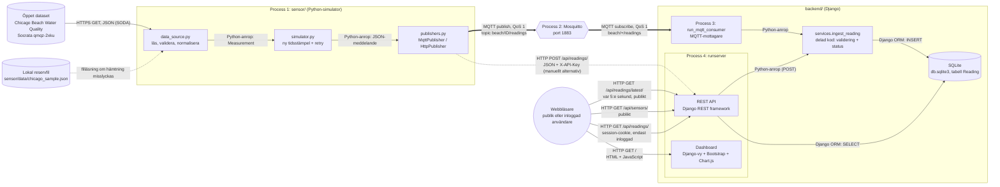
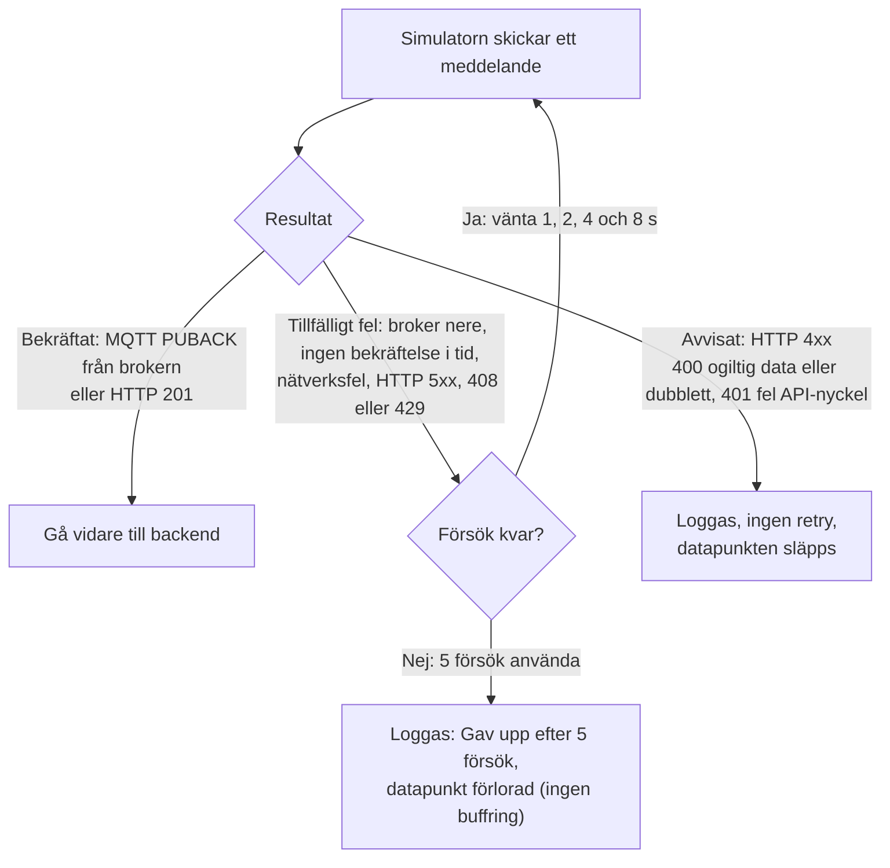
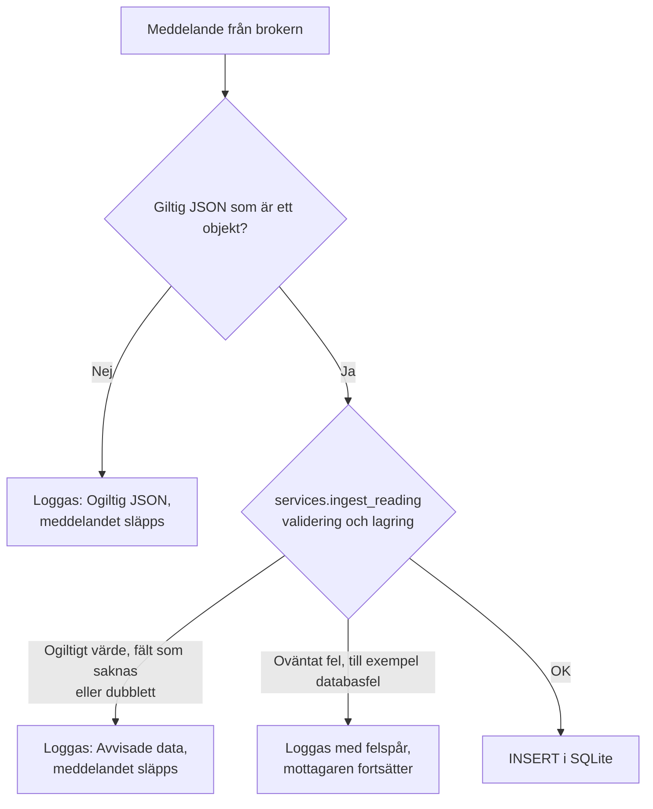

# Arkitektur & teknikval

Det här dokumentet beskriver det **implementerade mätdataflödet** från dataset till dashboard, komponentgränserna och vad som händer när något går fel. Kontoflöden och rapporter avgränsas separat i avsnittet *Utanför dataflödet*. Det gäller MVP:n med **simulerad sensordata**. Fysisk sensor, ESP32 och firmware (`firmware/`) ingår inte i flödet nedan.

Urvalet hämtar 25 giltiga rader per plats för Ohio Street Beach, 63rd Street Beach och Rainbow Beach med serverfilter före paginering. Simulatorn växlar mellan sex sensorer; reservfilen innehåller verifierade originalrader från samma platser. Historik byggs via mottagningsvägen utan direktinläst demodata.

## Dataflöde

Varje pil är namngiven med protokoll eller anropstyp. Tjocka pilar är huvudflödet över MQTT. Streckade pilar visar datasetets reservfil respektive det manuellt valda HTTP-alternativet.

**Meddelandeformat** (samma för MQTT och HTTP): JSON med `sensor_id`, `metric` (`turbidity` eller `temperature`), `timestamp` (UTC, ISO 8601), `value`, `unit` och `quality`. Backend beräknar och lagrar `status` (`OK` eller `ANOMALY`) tillsammans med mätningen. `threshold` lagras inte med mätningen utan hämtas från aktuell konfiguration vid serialisering av API-svaret.

### Komponenter och gränser

| Komponent | Process | Gräns mot nästa led | Mapp |
| --- | --- | --- | --- |
| Simulator | 1: `python -m sensor_sim` | Känner inte till Django. Pratar bara via nätverket: MQTT eller HTTP med JSON-meddelandet ovan | `sensor/sensor_sim/` |
| MQTT-broker | 2: Mosquitto (`docker compose up -d`) | Förmedlar meddelanden och kopplar loss sensor från backend. Sparar ingenting | `infra/mosquitto.conf`, `docker-compose.yml` |
| MQTT-mottagare | 3: `manage.py run_mqtt_consumer` | Egen process utan HTTP. Anropar `services.ingest_reading` och skriver till SQLite | `backend/monitoring/mqtt_consumer.py` |
| REST API + dashboard | 4: `manage.py runserver` | Tar emot `POST` med API-nyckel, läser ut data och serverar dashboarden | `backend/monitoring/views.py`, `urls.py`, `templates`, `static` |
| Gemensam logik | körs i process 3 och 4 | En enda plats för validering och statusberäkning, oavsett transport | `backend/monitoring/services.py`, `serializers.py` |
| Databas | filen `backend/db.sqlite3` | Delas av process 3 och 4. Unik regel på `(sensor_id, timestamp)` stoppar dubbletter | `backend/monitoring/models.py` |
| Dashboard (webbläsare) | körs hos användaren | Hämtar data via API:t var 5:e sekund. Skyddet ligger i backend, inte i gränssnittet | `static/monitoring/dashboard.js` |

Med HTTP som transport hoppar flödet över process 2 och 3: simulatorn skickar direkt till API:t i process 4. Transporten väljs uttryckligen med `--transport http` eller `SENSOR_TRANSPORT=http`; simulatorn byter inte automatiskt till HTTP vid MQTT-fel.

### Åtkomst

| Anrop | Publik | Inloggad (session) |
| --- | --- | --- |
| `GET /` och `GET /api/readings/latest/` | Ja | Ja |
| `GET /api/sensors/` | Ja (den publika dashboarden anropar den inte) | Ja |
| `GET` och `HEAD /api/readings/` (historik) | Nej, HTTP 403 | Ja |
| `POST /api/readings/` | Maskinflöde med `X-API-Key` när `INGEST_API_KEY` är satt, annars öppet lokalt | Samma |

Mer om åtkomst finns i [`access-control.md`](access-control.md). Det dokumenterade transportbeslutet finns i [`protocol-decision.md`](protocol-decision.md).

## Felvägar

### 1. Från simulator till mottagning (leverans)

Obs: med MQTT bekräftar brokern bara att meddelandet tagits emot. Ogiltig data upptäcks först i mottagaren (diagram 2) och simulatorn får ingen återkoppling. Med HTTP får simulatorn svaret från backend direkt.

### 2. I MQTT-mottagaren

### 3. Övriga felvägar

| Var | Fel | Vad händer |
| --- | --- | --- |
| Dataset | Hämtning från Socrata misslyckas (nätverk, HTTP-fel, ogiltig JSON) eller ger inga giltiga värden | Varning loggas och simulatorn använder `chicago_sample.json` |
| Dataset | Rad eller värde är ogiltigt (strandnamn, tid, NaN, negativ turbiditet, temperatur utanför −5…50 °C) | Värdet avvisas och räknas per orsak i en varning. Reglerna finns i [`data-rules.md`](data-rules.md) |
| Simulator | Okänd `--transport` | Programmet avbryts med ett fel vid start |
| Broker | Mottagaren tappar kontakten | Loggar `Bortkopplad`, återansluter med 1–30 s mellanrum och prenumererar på nytt |
| Broker | Brokern är nere när mottagaren startar | Mottagaren startar ändå och försöker ansluta tills det lyckas |
| Broker | Mottagaren är nere medan simulatorn skickar | Mottagaren använder ren MQTT-session, så mätningar som publiceras under avbrottet levereras inte i efterhand |
| API | `POST` med ogiltig data eller redan sparad `sensor_id` och `timestamp` | HTTP 400 med felbeskrivning, ingenting sparas |
| API | `POST` med fel eller saknad API-nyckel (när `INGEST_API_KEY` är satt) | HTTP 401 |
| API | Anonym `GET` mot historik | HTTP 403, ingen data returneras |
| API | `GET /api/readings/latest/?sensor_id=` för okänd sensor | HTTP 404 |
| API | Ogiltigt filter i historik (datum, `sensor_id`, `limit`, `order`) | HTTP 400 med felbeskrivning |
| API | Databasen svarar inte | HTTP 500. `GET /api/health/` kontrollerar databasanslutningen och svarar 200 när den fungerar |
| Dashboard | API-anrop misslyckas | Banderoll "Kunde inte hämta data", senaste kort visas kvar, nästa försök efter 5 s |
| Dashboard | Senaste mätningen är äldre än `READING_STALE_SECONDS` (300 s) | Kortet markeras som inaktuellt |

Kända begränsningar: sändaren har ingen buffring, så en mätning går förlorad om brokern är borta längre än retry-fönstret (cirka 15 s plus anslutningstid). Se [`mqtt.md`](mqtt.md) för mättestet.

## Utanför dataflödet

- **Fysisk sensor, ESP32 och firmware** ingår inte i MVP:n. Mappen `firmware/` finns i repot men används inte i flödet ovan.
- **E-posttjänsten** (`backend/monitoring/emails.py`, [`email.md`](email.md)) används för inbjudningar, lösenordsåterställning och datavarningar via konfigurerad SMTP. Vid en avvikelse skapar `ingest_reading` en `Alert` och användarspecifika `Notification`-poster i samma transaktion som mätningen. Efter commit försöker `notifications.py` skicka e-post. Dessa sidoflöden visas inte i diagrammet.

De nya kraven kompletterar mätdataflödet med konton, meddelanden och rapporter. Diagrammet ovan gör inte anspråk på att visa hela den utökade plattformen.

- **Implementerade kontofunktioner:** inloggning och POST-baserad utloggning, publik dashboard och sessionsskyddad historik (se [`access-control.md`](access-control.md)), lösenordsåterställning och lösenordsbyte (se [`password.md`](password.md)) samt administratörsskapade kontoinbjudningar med tre dagars giltighet och omskick (se [`invitations.md`](invitations.md)).
- **Implementerade rapporter och meddelanden:** PDF-export av historik via `/api/reports/history.pdf` med sensor- och tidsfilter (se [`history-pdf.md`](history-pdf.md)), automatiska datavarningar med sparade användarmeddelanden (se [`notifications.md`](notifications.md)) samt felrapport på skärm och som PDF (se [`error-reports.md`](error-reports.md)). Historik, meddelanden och rapporter kräver inloggning; meddelanden och felrapporter avgränsas till den aktuella användaren.

## Så hänger diagrammet ihop med koden

| Pil | Implementation |
| --- | --- |
| Dataset → data_source | `fetch_remote` i `sensor/sensor_sim/data_source.py` (HTTPS GET), reservväg `load_sample` |
| data_source → simulator → publisher | `Simulator.tick`, `build_message` och `create_publisher` i `sensor/sensor_sim/` |
| publisher → broker | `MqttPublisher.send`: `publish(topic, qos=1)` med topic `beach/<sensor_id>/readings` |
| publisher → API | `HttpPublisher.send`: `POST` med `X-API-Key` |
| broker → mottagare | `MqttIngestor`: `subscribe("beach/+/readings", qos=1)` |
| mottagare/API → services | `services.ingest_reading` anropas från `MqttIngestor.handle_message` och `ReadingListCreateView.post` |
| services → databas | `ingest_reading` validerar med `ReadingSerializer` och sparar med `serializer.save` (Django ORM) |
| användare → API/dashboard | `DashboardView`, `LatestReadingView`, `SensorListView`, `ReadingListCreateView` i `views.py`, hämtning var 5:e sekund (`REFRESH_MS`) i `dashboard.js` |

Hela kedjan körs och verifieras med `python -m tools.verify_flow` och testet `test_end_to_end.py`, se [`end-to-end.md`](end-to-end.md).

## Modulseparation

| Modul | Ansvar | Mapp |
| --- | --- | --- |
| Sensor-simulering | datakälla, meddelande, transport, retry | `sensor/sensor_sim/` |
| Backend | validering, statuslogik, API, MQTT-ingest | `backend/monitoring/` |
| Databas | modell, index, constraints | `backend/monitoring/models.py` |
| Frontend | dashboard (mall + JS) | `backend/monitoring/templates`, `static` |

`services.py` är gemensam för HTTP och MQTT, så validering och statuslogik finns på ett enda ställe.

## Teknikval

- **MQTT (protokoll):** lättviktigt publish/subscribe-protokoll byggt för IoT. Låg overhead, QoS 1 (minst-en-gång-leverans), brokern kopplar loss sensor från backend, och fler sensorer kan läggas till utan ändrad backend. HTTP-läget är ett manuellt valt alternativ för enkel lokal testning utan broker.
- **Django + DRF:** krav i uppgiften; ORM, migrationer, admin och serializers ger validering och ren separation.
- **SQLite (lokalt):** kräver ingen separat databasserver och förenklar en ren lokal start. Index på `timestamp` och `(sensor_id, -timestamp)` stödjer tidsfiltrering och senaste värde; en unik constraint på `(sensor_id, timestamp)` stoppar dubletter. Det passar MVP:ns lokala datalagring, men är inte ett belägg för kapacitet vid hög skrivbelastning.
- **Bootstrap + Chart.js:** snabb, responsiv och lättbegriplig dashboard utan byggsteg.
- **Django-sessioner:** används för mänskliga användare och skyddad historik. Behörighet kontrolleras i backend; gränssnittet är inte den enda skyddsnivån.
- **Felhantering:** exponentiell backoff vid tillfälliga transportfel, inklusive HTTP 408, 429 och 5xx. Övriga HTTP 4xx avvisas utan retry. Backend avvisar ogiltig data. Mätdataflödets felvägar beskrivs ovan; kontoflödenas och rapporternas hantering beskrivs i respektive länkad dokumentation.

## Begränsningar och skalbarhet (#32)

### Befintliga skydd och verktyg

Historik-API:t begränsar svaret till högst 5 000 mätningar. Dashboarden och historik-PDF visar högst de senaste 200 mätningarna i valt intervall. Meddelanden och felrapport på skärm är sidindelade. Index och unika databasregler finns redan; detta ersätter inte belastningstestning.

Docker Compose startar den lokala Mosquitto-brokern, inte hela applikationen. GitHub Actions kontrollerar migrationer och kör backend-, simulator- och dashboardtester för pull requests och pushar till `development`, `Testing` och `main`. Automatiserade tester visar funktionell korrekthet men fastställer ingen maximal kapacitet.

### Nuvarande begränsningar

| Område | Begränsning i implementationen | Konsekvens vid ökad belastning |
| --- | --- | --- |
| Databas | HTTP-servern och MQTT-mottagaren delar en lokal SQLite-fil. | Samtidig skrivning kan ge låsväntan; fler processer ger inte automatiskt högre skrivkapacitet. |
| Senaste värde | `get_latest_per_sensor` hämtar sensor-ID:n och gör därefter en fråga per sensor. Dashboarden frågar var femte sekund per öppen webbläsare. | Databasarbete ökar med både antalet sensorer och antalet besökare. |
| Leverans av mätdata | Ingen beständig buffert hos simulatorn; MQTT använder ren session hos mottagaren. | Data kan gå förlorad vid längre avbrott, även om QoS 1 används mellan simulator och broker. |
| E-post | Leveransförsöken körs sekventiellt i den anropande processen efter databascommit, utan bakgrundskö. | Fler mottagare eller långsam SMTP kan fördröja nästa mätning eller HTTP-svar. Sparade meddelanden finns kvar vid leveransfel. |
| Felrapport som PDF | Alla matchande händelser tas med och dokumentet byggs i minnet. | Stora intervall kan kräva mer minne och längre svarstid än den sidindelade skärmvyn. |
| Lokal drift | MQTT-konfigurationen tillåter anonym åtkomst på port 1883 utan TLS; Django körs med `runserver` i lokalstarten. | Lokalstarten ska inte likställas med en färdig produktionsmiljö. |

### Nästa steg vid ett konstaterat behov

1. **Mät före teknikbyte:** kör ett reproducerbart belastningstest i en isolerad miljö med fler simulerade sensor-ID:n och samtidiga läsare. Dokumentera datamängd, svarstider, databasfrågor, minnesåtgång och eventuella skrivfel. Inga sådana kapacitetsvärden är fastställda här.
2. **Vid långsam läsning:** optimera först frågan för senaste värde och kontrollera indexanvändningen. Utvärdera aggregering för längre historik och begränsning eller separat generering av stora PDF-rapporter. Redis-cache är ett senare alternativ om mätningarna visar kvarstående behov.
3. **Vid skrivkonflikter eller behov av flera applikationsinstanser:** utvärdera PostgreSQL. Migrering, constraints, transaktioner och frågor måste då verifieras. TimescaleDB är ett separat alternativ om tidsseriens storlek motiverar det; ett byte antas inte fungera utan anpassning och tester.
4. **Vid långsamma utskick:** utvärdera en bakgrundskö för sparade meddelanden med kontrollerad retry och skydd mot dubbla leveransförsök. Bevara att mätning och meddelande sparas före e-postförsöket.
5. **Vid högre MQTT-volym eller krav på avbrottstålighet:** utvärdera beständig buffring och sessionshantering. Shared subscriptions kan utvärderas för flera mottagare; Kafka är ett alternativ först om volym och krav motiverar ett annat meddelandesystem. Batchskrivning med `bulk_create` är inte en direkt ersättning för `ingest_reading`: validering, statusberäkning, dubblettskydd samt skapande av varningar och meddelanden måste bevaras.
6. **Före drift utanför lokal miljö:** konfigurera MQTT med TLS, autentisering och ACL samt en lämplig applikationsserver och verifierade driftinställningar. API-nyckelskyddet för HTTP POST finns redan via `INGEST_API_KEY`, men måste vara konfigurerat för att krävas.

Dessa steg är villkorade alternativ, inte redan implementerade funktioner eller krav på att utöka MVP:n. Per sensor/plats konfigurerade gränser är också ett möjligt senare verksamhetsbehov; nuvarande gränser gäller per mätstorhet. Projektet fortsätter använda simulerade sensorer.
