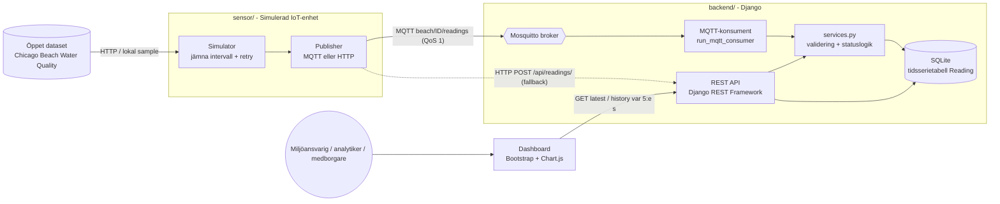

# Arkitektur & teknikval

## Logiskt arkitekturdiagram

**Dataflöde:** dataset → simulator (ny tidsstämpel + sensor_id) → MQTT → konsument → validering → databas → REST-API → dashboard.

## Modulseparation

| Modul | Ansvar | Mapp |
|---|---|---|
| Sensor-simulering | datakälla, meddelande, transport, retry | `sensor/sensor_sim/` |
| Backend | validering, statuslogik, API, MQTT-ingest | `backend/monitoring/` |
| Databas | modell, index, constraints | `backend/monitoring/models.py` |
| Frontend | dashboard (mall + JS) | `backend/monitoring/templates`, `static` |

`services.py` är gemensam för HTTP och MQTT, så validering och statuslogik finns på ett enda ställe.

## Teknikval

- **MQTT (protokoll):** lättviktigt publish/subscribe-protokoll byggt för IoT. Låg overhead, QoS 1 (minst-en-gång-leverans), brokern kopplar loss sensor från backend, och fler sensorer kan läggas till utan ändrad backend. HTTP-läget finns som fallback för enkel lokal testning utan broker.
- **Django + DRF:** krav i uppgiften; ORM, migrationer, admin och serializers ger validering och ren separation.
- **SQLite (lokalt):** noll installation. Tidsserieegenskaper uppnås med index på `timestamp` och `(sensor_id, -timestamp)` samt unik constraint `(sensor_id, timestamp)` mot dubletter.
- **Bootstrap + Chart.js:** snabb, responsiv och lättbegriplig dashboard utan byggsteg.
- **Felhantering:** exponentiell backoff vid tillfälliga fel, ingen retry vid avvisad data (HTTP 400), allt loggas. Backend avvisar ogiltig data.

## Reflektion kring skalbarhet

- Byt SQLite mot **PostgreSQL + TimescaleDB** (hypertables, kompression, retention, continuous aggregates); Django-modellen fungerar i princip oförändrad.
- Flera konsument-instanser med **MQTT shared subscriptions**, eller Kafka vid mycket hög volym; skriv i batchar (`bulk_create`).
- Nedsampling/aggregering för långa historikperioder, cache (Redis) för "senaste värde", paginering av historik.
- MQTT över TLS med autentisering/ACL per sensor; API-nyckel för POST finns via `INGEST_API_KEY`.
- Containerisering (Docker) och CI (tester vid varje push).
- Tröskelvärdena är konfigurerade per mätstorhet; per sensor/plats är en möjlig senare utökning.
