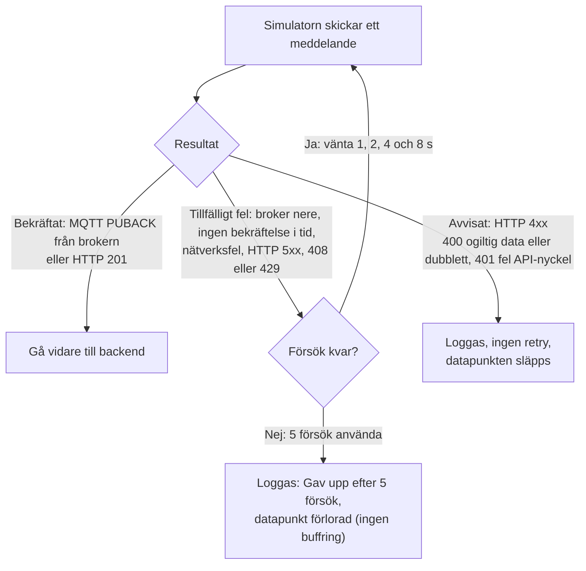
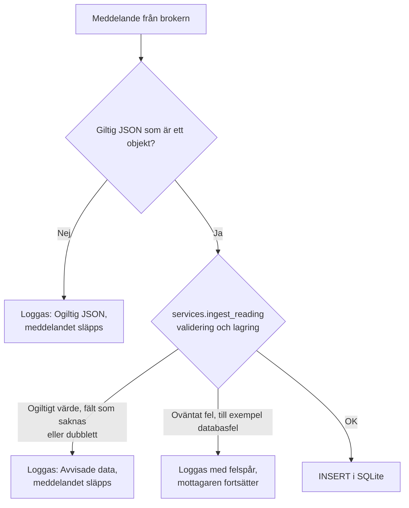

# Arkitektur & teknikval

Det här dokumentet beskriver det **implementerade** systemet: dataflödet från dataset till dashboard, komponentgränserna och vad som händer när något går fel. Det gäller MVP:n med **simulerad sensordata**. Fysisk sensor, ESP32 och firmware (`firmware/`) ingår inte i flödet nedan.

## Dataflöde

Varje pil är namngiven med protokoll eller anropstyp. Tjocka pilar är huvudflödet över MQTT, streckade pilar är reservvägar.

```mermaid
flowchart LR
    DS[("Öppet dataset<br/>Chicago Beach Water Quality<br/>Socrata qmqz-2xku")]
    SAMPLE[("Lokal reservfil<br/>sensor/data/chicago_sample.json")]

    subgraph P1["Process 1: sensor/ (Python-simulator)"]
        LOAD["data_source.py<br/>läs, validera, normalisera"]
        SIM["simulator.py<br/>ny tidsstämpel + retry"]
        PUB["publishers.py<br/>MqttPublisher / HttpPublisher"]
    end

    BR{{"Process 2: Mosquitto<br/>port 1883"}}

    subgraph BE["backend/ (Django)"]
        CON["Process 3: run_mqtt_consumer<br/>MQTT-mottagare"]
        subgraph P4["Process 4: runserver"]
            API["REST API<br/>Django REST framework"]
            WEB["Dashboard<br/>Django-vy + Bootstrap + Chart.js"]
        end
        SVC["services.ingest_reading<br/>delad kod: validering + status"]
        DB[("SQLite<br/>db.sqlite3, tabell Reading")]
    end

    USER(("Webbläsare<br/>publik eller inloggad användare"))

    DS -->|"HTTPS GET, JSON (SODA)"| LOAD
    SAMPLE -.->|"filläsning om hämtning misslyckas"| LOAD
    LOAD -->|"Python-anrop: Measurement"| SIM
    SIM -->|"Python-anrop: JSON-meddelande"| PUB
    PUB ==>|"MQTT publish, QoS 1<br/>topic beach/ID/readings"| BR
    PUB -.->|"HTTP POST /api/readings/<br/>JSON + X-API-Key (reserv)"| API
    BR ==>|"MQTT subscribe, QoS 1<br/>beach/+/readings"| CON
    CON -->|"Python-anrop"| SVC
    API -->|"Python-anrop (POST)"| SVC
    SVC -->|"Django ORM: INSERT"| DB
    API -->|"Django ORM: SELECT"| DB
    USER -->|"HTTP GET /<br/>HTML + JavaScript"| WEB
    USER -->|"HTTP GET /api/readings/latest/<br/>var 5:e sekund, publikt"| API
    USER -->|"HTTP GET /api/sensors/ och /api/readings/<br/>session-cookie, endast inloggad"| API
```

**Meddelandeformat** (samma för MQTT och HTTP): JSON med `sensor_id`, `metric` (`turbidity` eller `temperature`), `timestamp` (UTC, ISO 8601), `value`, `unit` och `quality`. Backend lägger till `status` (`OK` eller `ANOMALY`) och `threshold` när värdet sparas och läses.

### Komponenter och gränser

| Komponent | Process | Gräns mot nästa led | Mapp |
| --- | --- | --- | --- |
| Simulator | 1: `python -m sensor_sim` | Känner inte till Django. Pratar bara via nätverket: MQTT eller HTTP med JSON-meddelandet ovan | `sensor/sensor_sim/` |
| MQTT-broker | 2: Mosquitto (`docker compose up -d`) | Förmedlar meddelanden och kopplar loss sensor från backend. Sparar ingenting | `infra/mosquitto.conf`, `docker-compose.yml` |
| MQTT-mottagare | 3: `manage.py run_mqtt_consumer` | Egen process utan HTTP. Anropar `services.ingest_reading` och skriver till SQLite | `backend/monitoring/mqtt_consumer.py` |
| REST API + dashboard | 4: `manage.py runserver` | Tar emot `POST` med API-nyckel, läser ut data och serverar dashboarden | `backend/monitoring/views.py`, `urls.py`, `templates`, `static` |
| Gemensam logik | körs i process 3 och 4 | En enda plats för validering och statusberäkning, oavsett transport | `backend/monitoring/services.py`, `serializers.py` |
| Databas | filen `backend/db.sqlite3` | Delas av process 3 och 4. Unik regel på `(sensor_id, timestamp)` stoppar dubbletter | `backend/monitoring/models.py` |
| Dashboard (webbläsare) | körs hos användaren | Hämtar data via API:t var 5:e sekund. Skyddet ligger i backend, inte i gränssnittet | `static/monitoring/dashboard.js` |

Med HTTP som transport hoppar flödet över process 2 och 3: simulatorn skickar direkt till API:t i process 4.

### Åtkomst

| Anrop | Publik | Inloggad (session) |
| --- | --- | --- |
| `GET /` och `GET /api/readings/latest/` | Ja | Ja |
| `GET /api/sensors/` | Ja (den publika dashboarden anropar den inte) | Ja |
| `GET` och `HEAD /api/readings/` (historik) | Nej, HTTP 403 | Ja |
| `POST /api/readings/` | Maskinflöde med `X-API-Key` när `INGEST_API_KEY` är satt, annars öppet lokalt | Samma |

Mer om åtkomst finns i [`access-control.md`](access-control.md). Det dokumenterade transportbeslutet finns i [`protocol-decision.md`](protocol-decision.md).

## Felvägar

### 1. Från simulator till mottagning (leverans)

Obs: med MQTT bekräftar brokern bara att meddelandet tagits emot. Ogiltig data upptäcks först i mottagaren (diagram 2) och simulatorn får ingen återkoppling. Med HTTP får simulatorn svaret från backend direkt.

### 2. I MQTT-mottagaren

### 3. Övriga felvägar

| Var | Fel | Vad händer |
| --- | --- | --- |
| Dataset | Hämtning från Socrata misslyckas (nätverk, HTTP-fel, ogiltig JSON) eller ger inga giltiga värden | Varning loggas och simulatorn använder `chicago_sample.json` |
| Dataset | Rad eller värde är ogiltigt (strandnamn, tid, NaN, negativ turbiditet, temperatur utanför −5…50 °C) | Värdet avvisas och räknas per orsak i en varning. Reglerna finns i [`data-rules.md`](data-rules.md) |
| Simulator | Okänd `--transport` | Programmet avbryts med ett fel vid start |
| Broker | Mottagaren tappar kontakten | Loggar `Bortkopplad`, återansluter med 1–30 s mellanrum och prenumererar på nytt |
| Broker | Brokern är nere när mottagaren startar | Mottagaren startar ändå och försöker ansluta tills det lyckas |
| Broker | Mottagaren är nere medan simulatorn skickar | Mottagaren använder ren MQTT-session, så mätningar som publiceras under avbrottet levereras inte i efterhand |
| API | `POST` med ogiltig data eller redan sparad `sensor_id` och `timestamp` | HTTP 400 med felbeskrivning, ingenting sparas |
| API | `POST` med fel eller saknad API-nyckel (när `INGEST_API_KEY` är satt) | HTTP 401 |
| API | Anonym `GET` mot historik | HTTP 403, ingen data returneras |
| API | `GET /api/readings/latest/?sensor_id=` för okänd sensor | HTTP 404 |
| API | Ogiltigt filter i historik (datum, `sensor_id`, `limit`, `order`) | HTTP 400 med felbeskrivning |
| API | Databasen svarar inte | HTTP 500. `GET /api/health/` kontrollerar databasanslutningen och svarar 200 när den fungerar |
| Dashboard | API-anrop misslyckas | Banderoll "Kunde inte hämta data", senaste kort visas kvar, nästa försök efter 5 s |
| Dashboard | Senaste mätningen är äldre än `READING_STALE_SECONDS` (300 s) | Kortet markeras som inaktuellt |

Kända begränsningar: sändaren har ingen buffring, så en mätning går förlorad om brokern är borta längre än retry-fönstret (cirka 15 s plus anslutningstid). Se [`mqtt.md`](mqtt.md) för mättestet.

## Utanför dataflödet

- **Fysisk sensor, ESP32 och firmware** ingår inte i MVP:n. Mappen `firmware/` finns i repot men används inte i flödet ovan.
- **E-posttjänsten** (`backend/monitoring/emails.py`, [`email.md`](email.md)) är en separat tjänst. Inget i dataflödet ovan skickar e-post ännu; varningar via e-post och inbjudningar byggs i separata issues.

## Så hänger diagrammet ihop med koden

| Pil | Implementation |
| --- | --- |
| Dataset → data_source | `fetch_remote` i `sensor/sensor_sim/data_source.py` (HTTPS GET), reservväg `load_sample` |
| data_source → simulator → publisher | `Simulator.tick`, `build_message` och `create_publisher` i `sensor/sensor_sim/` |
| publisher → broker | `MqttPublisher.send`: `publish(topic, qos=1)` med topic `beach/<sensor_id>/readings` |
| publisher → API | `HttpPublisher.send`: `POST` med `X-API-Key` |
| broker → mottagare | `MqttIngestor`: `subscribe("beach/+/readings", qos=1)` |
| mottagare/API → services | `services.ingest_reading` anropas från `MqttIngestor.handle_message` och `ReadingListCreateView.post` |
| services → databas | `ingest_reading` validerar med `ReadingSerializer` och sparar med `serializer.save` (Django ORM) |
| användare → API/dashboard | `DashboardView`, `LatestReadingView`, `SensorListView`, `ReadingListCreateView` i `views.py`, hämtning var 5:e sekund (`REFRESH_MS`) i `dashboard.js` |

Hela kedjan körs och verifieras med `python -m tools.verify_flow` och testet `test_end_to_end.py`, se [`end-to-end.md`](end-to-end.md).

## Modulseparation

| Modul | Ansvar | Mapp |
| --- | --- | --- |
| Sensor-simulering | datakälla, meddelande, transport, retry | `sensor/sensor_sim/` |
| Backend | validering, statuslogik, API, MQTT-ingest | `backend/monitoring/` |
| Databas | modell, index, constraints | `backend/monitoring/models.py` |
| Frontend | dashboard (mall + JS) | `backend/monitoring/templates`, `static` |

`services.py` är gemensam för HTTP och MQTT, så validering och statuslogik finns på ett enda ställe.

## Teknikval

- **MQTT (protokoll):** lättviktigt publish/subscribe-protokoll byggt för IoT. Låg overhead, QoS 1 (minst-en-gång-leverans), brokern kopplar loss sensor från backend, och fler sensorer kan läggas till utan ändrad backend. HTTP-läget finns som fallback för enkel lokal testning utan broker.
- **Django + DRF:** krav i uppgiften; ORM, migrationer, admin och serializers ger validering och ren separation.
- **SQLite (lokalt):** noll installation. Tidsserieegenskaper uppnås med index på `timestamp` och `(sensor_id, -timestamp)` samt unik constraint `(sensor_id, timestamp)` mot dubletter.
- **Bootstrap + Chart.js:** snabb, responsiv och lättbegriplig dashboard utan byggsteg.
- **Django-sessioner:** används för mänskliga användare och skyddad historik. Behörighet kontrolleras i backend; gränssnittet är inte den enda skyddsnivån.
- **Felhantering:** exponentiell backoff vid tillfälliga fel, ingen retry vid avvisad data (HTTP 4xx), allt loggas. Backend avvisar ogiltig data. Alla felvägar beskrivs i avsnittet *Felvägar* ovan.

## Reflektion kring skalbarhet

- Byt SQLite mot **PostgreSQL + TimescaleDB** (hypertables, kompression, retention, continuous aggregates); Django-modellen fungerar i princip oförändrad.
- Flera konsument-instanser med **MQTT shared subscriptions**, eller Kafka vid mycket hög volym; skriv i batchar (`bulk_create`).
- Nedsampling/aggregering för långa historikperioder, cache (Redis) för "senaste värde", paginering av historik.
- MQTT över TLS med autentisering/ACL per sensor; API-nyckel för POST finns via `INGEST_API_KEY`.
- Containerisering (Docker) och CI (tester vid varje push).
- Tröskelvärdena är konfigurerade per mätstorhet; per sensor/plats är en möjlig senare utökning.
