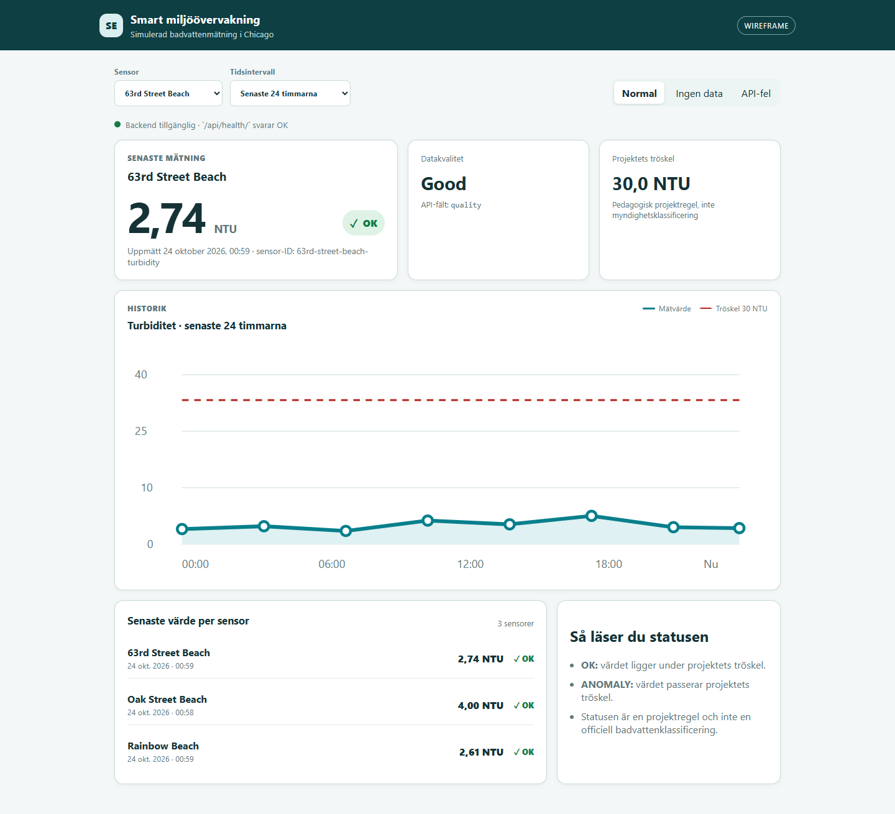
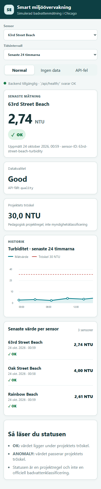

# Dashboard-wireframe

Den här wireframen beskriver den publika dashboarden innan den kopplas till det riktiga API:t. Öppna [`dashboard-wireframe.html`](dashboard-wireframe.html) direkt i en webbläsare.

## Förhandsvisningar

### Dator



### Mobil



## Underlag från API-testerna

Wireframen använder följande verifierade endpoints och fält:

| Endpoint | Användning i dashboarden |
|---|---|
| `GET /api/health/` | Visar om backend är tillgänglig |
| `GET /api/sensors/` | Fyller sensorväljaren |
| `GET /api/readings/` | Hämtar historiska mätvärden |
| `GET /api/readings/latest/` | Hämtar senaste värdet per sensor |

Verifierade sensorer:

- `63rd-street-beach-turbidity`
- `oak-street-beach-turbidity`
- `rainbow-beach-turbidity`

Verifierade fält i en mätning:

```json
{
  "id": 2,
  "sensor_id": "63rd-street-beach-turbidity",
  "timestamp": "2026-10-23T22:59:02.815194Z",
  "value": 2.74,
  "unit": "NTU",
  "quality": "good",
  "status": "OK"
}
```

API-svaret innehåller också `threshold` och `count`. I testresultatet var tröskeln `30.0`.

## Vyer och beteenden

Wireframen visar:

- vald strand/sensor,
- senaste värde och enhet,
- textbaserad status tillsammans med färg och symbol,
- kvalitet och senaste tidsstämpel,
- historiskt linjediagram med tröskellinje,
- val av sensor och tidsintervall,
- backendstatus,
- tomt läge när inga mätningar finns,
- felläge när API:t inte kan nås,
- responsiv layout för dator och mobil.

Knapparna **Normal**, **Ingen data** och **API-fel** används endast för att demonstrera wireframens olika tillstånd. Sensor- och tidsfilter är också lokala prototypkontroller.

## API-frågor som måste bekräftas

Innan den riktiga dashboarden implementeras behöver teamet besluta:

1. Hur `from`, `to`, sensorfilter och eventuell paginering skickas till `/api/readings/`.
2. Om `/api/readings/latest/` alltid returnerar en lista eller kan filtreras till en sensor.
3. Om `threshold` alltid är globalt eller kan skilja sig mellan sensorer.
4. Vilka möjliga värden `quality` och `status` kan ha.
5. När en mätning ska visas som gammal eller inaktuell.
6. Om CORS behöver aktiveras när frontend och Django körs på olika adresser.

## Acceptanskriterier för issue #8

- [x] Senaste värde, tid, status och historik visas.
- [x] Tomt läge, felläge och mobilvy finns.
- [x] Status kommuniceras med symbol, text och färg.

