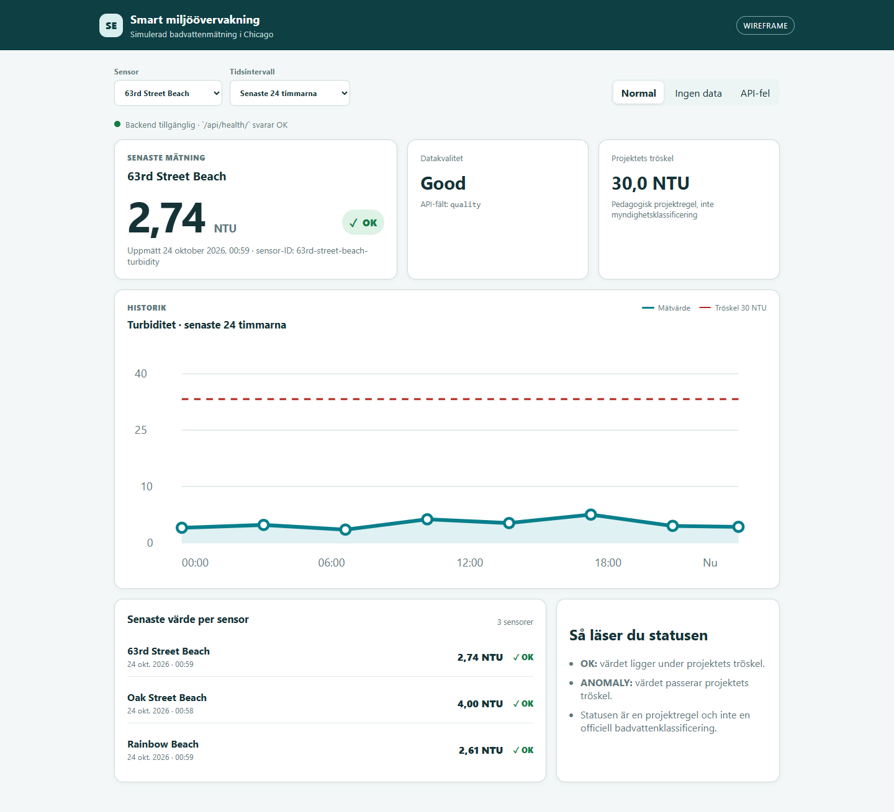
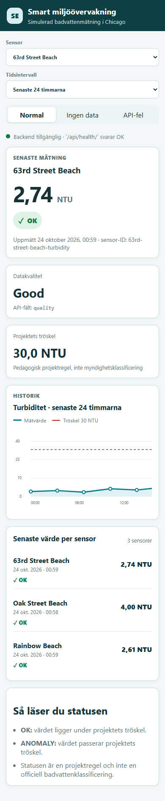

# Dashboard-wireframe

Den här wireframen är ett historiskt designunderlag från innan dashboarden kopplades till det riktiga API:t. Öppna [`dashboard-wireframe.html`](dashboard-wireframe.html) direkt i en webbläsare. Den körbara dashboarden finns i Django och följer den senare åtkomstmodellen i [`access-control.md`](access-control.md).

## Förhandsvisningar

### Dator



### Mobil



## Underlag från API-testerna

Wireframen använder följande verifierade endpoints och fält:

| Endpoint | Användning i dashboarden |
| --- | --- |
| `GET /api/health/` | Visar om backend är tillgänglig |
| `GET /api/sensors/` | Fyller sensorväljaren för inloggade användare |
| `GET /api/readings/` | Hämtar skyddad historik; session krävs |
| `GET /api/readings/latest/` | Hämtar senaste värdet per sensor |

Verifierade sensorer:

- `63rd-street-beach-turbidity`
- `oak-street-beach-turbidity`
- `rainbow-beach-turbidity`

Verifierade fält i en mätning:

```json
{
  "id": 2,
  "sensor_id": "63rd-street-beach-turbidity",
  "timestamp": "2026-10-23T22:59:02.815194Z",
  "value": 2.74,
  "unit": "NTU",
  "quality": "good",
  "status": "OK"
}
```

API-svaret innehåller också `threshold` och `count`. I testresultatet var tröskeln `30.0`.

## Vyer och beteenden

Wireframen visar:

- vald strand/sensor,
- senaste värde och enhet,
- textbaserad status tillsammans med färg och symbol,
- kvalitet och senaste tidsstämpel,
- historiskt linjediagram med tröskellinje,
- val av sensor och tidsintervall,
- backendstatus,
- tomt läge när inga mätningar finns,
- felläge när API:t inte kan nås,
- responsiv layout för dator och mobil.

Knapparna **Normal**, **Ingen data** och **API-fel** används endast för att demonstrera wireframens olika tillstånd. Sensor- och tidsfilter är också lokala prototypkontroller.

## Beslut efter wireframen

Följande frågor är nu beslutade i den körbara implementationen:

1. `sensor_id`, `start`, `end`, `order` och `limit` skickas som query-parametrar till `/api/readings/`.
2. `/api/readings/latest/` returnerar senaste värde per sensor och kan filtreras med `sensor_id`.
3. Tröskeln väljs per mätstorhet: turbiditet eller temperatur.
4. Dashboarden visar `OK` eller `ANOMALY`; `quality` lagras separat.
5. `READING_STALE_SECONDS` avgör när ett värde visas som inaktuellt.
6. Django serverar både dashboard och API lokalt, så CORS behövs inte i nuvarande upplägg.
7. Senaste värden är publika. Historik, sensorval och tidsfilter visas endast för inloggade användare och historik-API:t skyddas på serversidan.

## Acceptanskriterier för issue #8

- [x] Senaste värde, tid, status och historik visas.
- [x] Tomt läge, felläge och mobilvy finns.
- [x] Status kommuniceras med symbol, text och färg.
